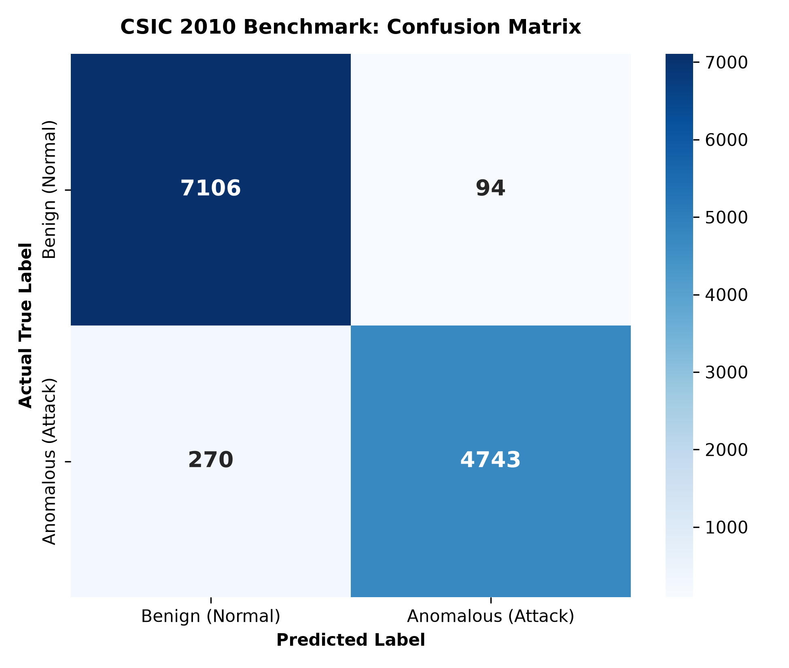

# 🛡️ SentinelAPI: AI-Powered API Security Gateway & Threat Monitoring System

> **A real-time, privacy-preserving Layer 7 API Security Gateway powered by dual-engine machine learning and FastAPI.**



## 📌 Project Overview
Modern web applications rely heavily on REST APIs, yet traditional Web Application Firewalls (WAFs) relying on static regex signatures struggle against obfuscation, encodings, and novel zero-day attacks. 

**SentinelAPI** acts as an inline reverse proxy that inspects incoming HTTP request parameters and bodies in real-time, evaluating them through a two-tier machine learning pipeline with **sub-10ms latency** without relying on third-party commercial cloud APIs.

---

## 🚀 Key Features
- **Dual-Engine Threat Detection:**
  - **Supervised Classifier:** TF-IDF Character N-Grams ($N \in [2, 4]$) + Random Forest Ensemble trained on **61,065 authentic requests** from the CSIC 2010 benchmark.
  - **Unsupervised Anomaly Detector:** Shannon Entropy calculation + Isolation Forest for zero-day anomaly detection.
- **Sub-10ms Real-Time Inline Proxying:** FastAPI asynchronous middleware inspecting request parameters and JSON bodies.
- **PostgreSQL Persistence:** Complete transaction audit logging of both ALLOWED and BLOCKED requests.
- **Live SOC Dashboard:** Real-time event streaming over **WebSockets**, Chart.js threat distribution donut charts, and an interactive attack simulation console.
- **Privacy-Preserving & 100% Offline:** Zero external API calls; all models run locally.

---

## 📊 Benchmark Results (CSIC 2010 HTTP Dataset)
Evaluated on **12,213 unseen test requests**:

| Metric | Score |
| :--- | :--- |
| **Overall Accuracy** | **97.02%** |
| **ROC-AUC Score** | **0.9951** |
| **Precision (Attack Detection)** | **0.98** |
| **Recall (Attack Detection)** | **0.95** |
| **Average Inspection Latency** | **< 5 ms** |

---

## 🛠️ Tech Stack
- **Backend & Gateway:** Python 3.10+, FastAPI, Uvicorn
- **Machine Learning:** Scikit-learn, Pandas, NumPy, Joblib
- **Database:** PostgreSQL 18, SQLAlchemy, Psycopg
- **Frontend / Dashboard:** HTML5, CSS3, JavaScript, Chart.js, WebSockets
- **Evaluation:** Matplotlib, Seaborn

---

## ⚙️ Installation & Quickstart

### 1. Clone & Set Up Environment
```bash
git clone https://github.com/Anusha-Hajari/sentinel-api-gateway.git
cd sentinel-api-gateway
python -m venv venv
source venv/bin/activate  # On Windows: .\venv\Scripts\Activate.ps1
pip install -r requirements.txt

### 2. Train the Models
bash
python dataset/parse_csic.py
python ml_engine/train.py
### 3. Start the Security Gateway
bash
uvicorn app.main:app --reload

Open http://127.0.0.1:8000/ to view the live dashboard.

4. Run Traffic Simulation
bash
python simulator/attack_sim.py
